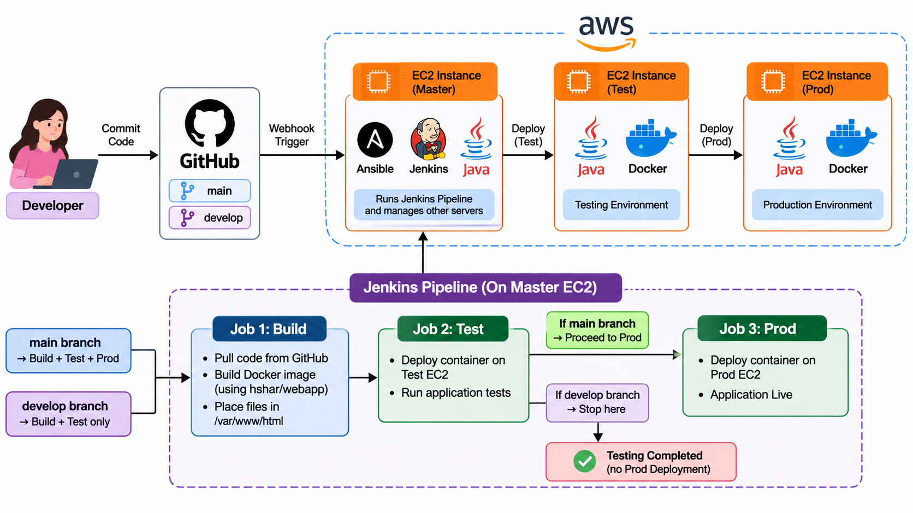
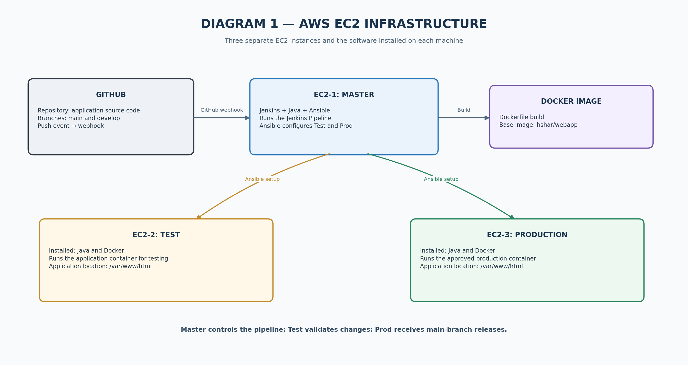
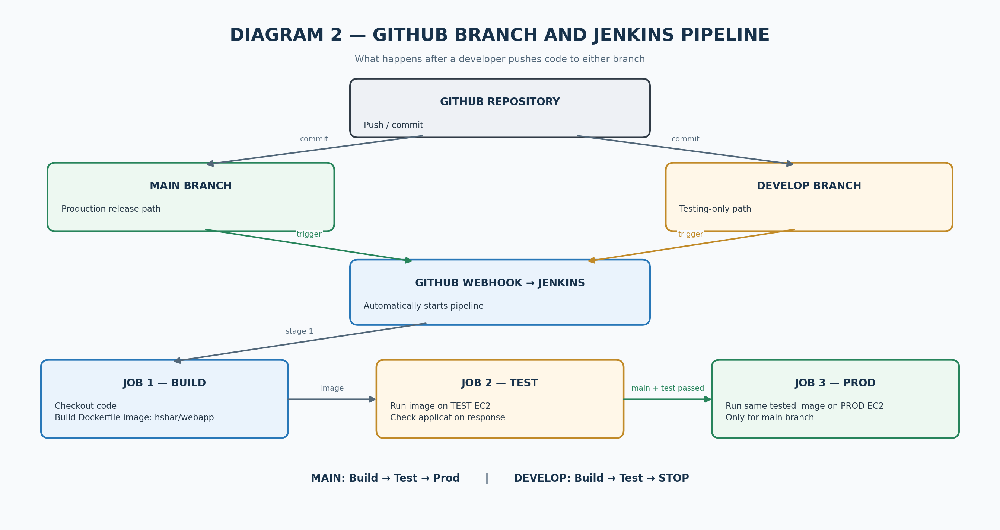

# DevOps Capstone Project 1

## Architecture Diagram

This architecture shows the flow from GitHub through the Jenkins master EC2 instance to test and production EC2 environments.

## Infrastructure

The infrastructure consists of:

- A GitHub repository for application source code
- EC2-1 Master running Jenkins, Java, and Ansible
- EC2-2 Test running Java and Docker
- EC2-3 Production running Java and Docker
- A Docker image based on `hshar/webapp`

## Pipelines

The Jenkins pipeline works as follows:

1. **Build** — Check out the code and build a Docker image.
2. **Test** — Deploy the image on the test EC2 instance and run application tests.
3. **Production** — For the `main` branch, deploy the tested image to the production EC2 instance.
4. The `develop` branch follows the build and test stages only; no production deployment occurs.
