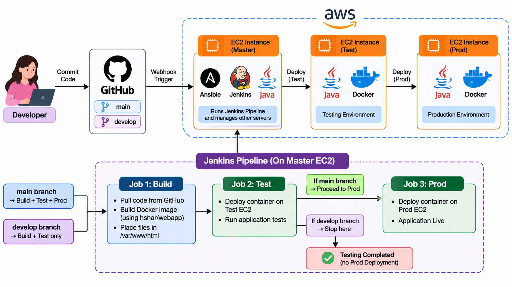

# DevOps Capstone Project 1

A hands-on DevOps project demonstrating an end-to-end CI/CD workflow using GitHub, Jenkins, Docker, Ansible, Java, and AWS EC2. Developer changes trigger the Jenkins pipeline, where code is built, tested, and deployed to test or production environments.

<!-- OVERVIEW:START -->
| # | Component | Project file | Topics covered |
|---|-----------|--------------|----------------|
| 1 | Architecture | [Architecture Diagram](architecture-diagram.png) | GitHub-to-Jenkins workflow and AWS deployment |
| 2 | Infrastructure | [AWS EC2 Infrastructure](infra.png) | Jenkins master, test EC2, production EC2, Docker |
| 3 | Pipeline | [GitHub and Jenkins Pipeline](pipelines.png) | Build, test, develop branch, main branch, production |
| 4 | Documentation | [Architecture.md](Architecture.md) | Architecture, infrastructure, and pipeline details |
| 5 | Ansible | [Ansible/](Ansible) | Install Ansible on an Ubuntu EC2 instance |
<!-- OVERVIEW:END -->

**Tools:** Git, GitHub, Jenkins, Docker, Ansible, Java, AWS EC2, Linux

## Architecture Diagram

## Infrastructure

The AWS infrastructure includes:

- **EC2-1 Master:** Jenkins, Java, and Ansible
- **EC2-2 Test:** Java and Docker
- **EC2-3 Production:** Java and Docker
- **Docker:** Application image built from `hshar/webapp`

## Pipelines

- **Job 1 — Build:** Pull code from GitHub and build the Docker image.
- **Job 2 — Test:** Deploy the image on the test EC2 instance and run application tests.
- **Job 3 — Production:** Deploy the tested image to production when changes come from the `main` branch.
- The `develop` branch builds and tests, but does not deploy to production.

## Project files

<!-- PROJECT-FILES:START -->
| File / Folder | What's inside |
|---------------|---------------|
| 📁 [Ansible/](Ansible) | Install Ansible on an Ubuntu EC2 instance |
| &nbsp;&nbsp;&nbsp;&nbsp;📄 [install_code.yml](Ansible/install_code.yml) | YAML configuration |
| &nbsp;&nbsp;&nbsp;&nbsp;📄 [Jenkins.md](Ansible/Jenkins.md) | Documentation |
| &nbsp;&nbsp;&nbsp;&nbsp;📄 [jenkins.md](Ansible/jenkins.md) | DevOps Capstone Project 1 |
| &nbsp;&nbsp;&nbsp;&nbsp;📄 [localhost.sh](Ansible/localhost.sh) | Shell script |
| &nbsp;&nbsp;&nbsp;&nbsp;📄 [playbook.yml](Ansible/playbook.yml) | YAML configuration |
| &nbsp;&nbsp;&nbsp;&nbsp;📄 [README.md](Ansible/README.md) | Install Ansible on an Ubuntu EC2 instance |
| &nbsp;&nbsp;&nbsp;&nbsp;📄 [slave.sh](Ansible/slave.sh) | Shell script |
| 🖼️ [architecture-diagram.png](architecture-diagram.png) | Complete project architecture diagram |
| 📄 [Architecture.md](Architecture.md) | Detailed architecture, infrastructure, and pipeline documentation |
| 🖼️ [infra.png](infra.png) | AWS EC2 infrastructure diagram |
| 🖼️ [pipelines.png](pipelines.png) | GitHub branch and Jenkins pipeline diagram |
<!-- PROJECT-FILES:END -->

## Adding files to the project

Both tables above update automatically. When you add, delete or rename a file or folder, the [Update README tables](.github/workflows/update-readme.yml) workflow adds or removes its linked row in both tables. Edits to existing files don't touch the README.

New rows get an automatic description. To change one, edit the text in the table; the workflow keeps your wording.
