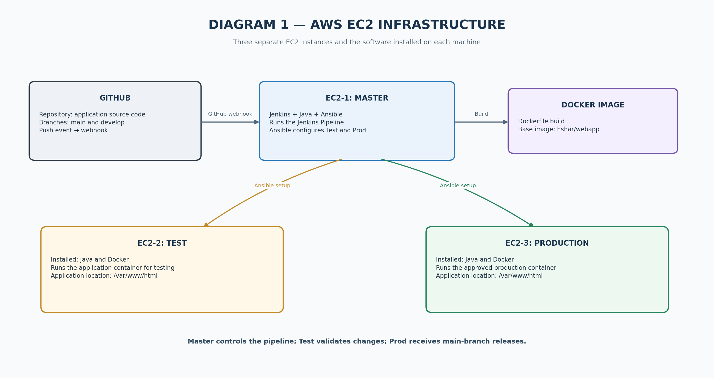

# DevOps Capstone Project 1

A hands-on DevOps project demonstrating an end-to-end CI/CD workflow using GitHub, Jenkins, Docker, Ansible, Java, and AWS EC2. Developer changes trigger the Jenkins pipeline, where code is built, tested, and deployed to test or production environments.

| # | Component | Project file | Topics covered |
|---|---------|--------------|----------------|
| 1 | Architecture | [Architecture Diagram](architecture-diagram.png) | GitHub-to-Jenkins workflow and AWS deployment |
| 2 | Infrastructure | [AWS EC2 Infrastructure](infra.png) | Jenkins master, test EC2, production EC2, Docker |
| 3 | Pipeline | [GitHub and Jenkins Pipeline](pipelines.png) | Build, test, develop branch, main branch, production |
| 4 | Documentation | [Architecture.md](Architecture.md) | Architecture, infrastructure, and pipeline details |

**Tools:** Git, GitHub, Jenkins, Docker, Ansible, Java, AWS EC2, Linux

## Architecture Diagram


## Infrastructure



The AWS infrastructure includes:

- **EC2-1 Master:** Jenkins, Java, and Ansible
- **EC2-2 Test:** Java and Docker
- **EC2-3 Production:** Java and Docker
- **Docker:** Application image built from `hshar/webapp`

## Pipelines


- **Job 1 — Build:** Pull code from GitHub and build the Docker image.
- **Job 2 — Test:** Deploy the image on the test EC2 instance and run application tests.
- **Job 3 — Production:** Deploy the tested image to production when changes come from the `main` branch.
- The `develop` branch builds and tests, but does not deploy to production.

## Project files

| File | What's inside |
|------|---------------|
| [Architecture.md](Architecture.md) | Detailed architecture, infrastructure, and pipeline documentation |
| [architecture-diagram.png](architecture-diagram.png) | Complete project architecture diagram |
| [infra.png](infra.png) | AWS EC2 infrastructure diagram |
| [pipelines.png](pipelines.png) | GitHub branch and Jenkins pipeline diagram |

## Adding files to the project

Whenever another file is added to this repository, add a linked row under **Project files** using its repository-relative path. For example:

```markdown
| [Jenkinsfile](Jenkinsfile) | Jenkins pipeline configuration |
| [Dockerfile](Dockerfile) | Instructions for building the application Docker image |
```

Use `[file-name](path/file-name)` for a document or code file and `` to display an image in this README.
