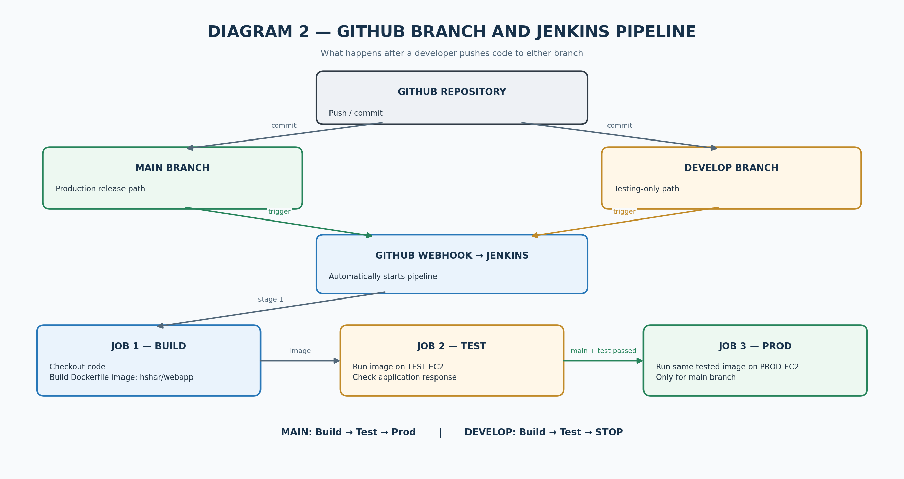

# DevOps Capstone Project 1

A hands-on DevOps project demonstrating an end-to-end CI/CD workflow using GitHub, Jenkins, Docker, Ansible, Java, and AWS EC2. Developer changes trigger the Jenkins pipeline, where code is built, tested, and deployed to test or production environments.

<!-- OVERVIEW:START -->
| # | Component | Project file | Topics covered |
|---|-----------|--------------|----------------|
| 1 | Architecture | [Architecture Diagram](architecture-diagram.png) | GitHub-to-Jenkins workflow and AWS deployment |
| 2 | Infrastructure | [AWS EC2 Infrastructure](infra.png) | Jenkins master, test EC2, production EC2, Docker |
| 3 | Pipeline | [GitHub and Jenkins Pipeline](pipelines.png) | Build, test, develop branch, main branch, production |
| 4 | Documentation | [Architecture.md](Architecture.md) | Architecture, infrastructure, and pipeline details |
| 5 | Ansible | [Ansible/](Ansible) | Install Ansible on an Ubuntu EC2 instance |
| 6 | Main | [Main.md](Main.md) | DevOps Capstone Project 1 |
<!-- OVERVIEW:END -->

**Tools:** Git, GitHub, Jenkins, Docker, Ansible, Java, AWS EC2, Linux

## Architecture Diagram

## Infrastructure

The AWS infrastructure includes:

- **EC2-1 Master:** Jenkins, Java, and Ansible
- **EC2-2 Test:** Java and Docker
- **EC2-3 Production:** Java and Docker
- **Docker:** Application image built from `hshar/webapp`

## Pipelines

- **Job 1 — Build:** Pull code from GitHub and build the Docker image.
- **Job 2 — Test:** Deploy the image on the test EC2 instance and run application tests.
- **Job 3 — Production:** Deploy the tested image to production when changes come from the `main` branch.
- The `develop` branch builds and tests, but does not deploy to production.

## Project files

<!-- PROJECT-FILES:START -->
| File / Folder | What's inside |
|---------------|---------------|
| 📁 [Ansible/](Ansible) | Install Ansible on an Ubuntu EC2 instance |
| &nbsp;&nbsp;&nbsp;&nbsp;🖼️ [image1.png](Ansible/image1.png) | Image1 image |
| &nbsp;&nbsp;&nbsp;&nbsp;🖼️ [image10.png](Ansible/image10.png) | Image10 image |
| &nbsp;&nbsp;&nbsp;&nbsp;🖼️ [image11.png](Ansible/image11.png) | Image11 image |
| &nbsp;&nbsp;&nbsp;&nbsp;🖼️ [image12.png](Ansible/image12.png) | Image12 image |
| &nbsp;&nbsp;&nbsp;&nbsp;🖼️ [image13.png](Ansible/image13.png) | Image13 image |
| &nbsp;&nbsp;&nbsp;&nbsp;🖼️ [image14.png](Ansible/image14.png) | Image14 image |
| &nbsp;&nbsp;&nbsp;&nbsp;🖼️ [image15.png](Ansible/image15.png) | Image15 image |
| &nbsp;&nbsp;&nbsp;&nbsp;🖼️ [image16.png](Ansible/image16.png) | Image16 image |
| &nbsp;&nbsp;&nbsp;&nbsp;🖼️ [image17.png](Ansible/image17.png) | Image17 image |
| &nbsp;&nbsp;&nbsp;&nbsp;🖼️ [image18.png](Ansible/image18.png) | Image18 image |
| &nbsp;&nbsp;&nbsp;&nbsp;🖼️ [image19.png](Ansible/image19.png) | Image19 image |
| &nbsp;&nbsp;&nbsp;&nbsp;🖼️ [image2.png](Ansible/image2.png) | Image2 image |
| &nbsp;&nbsp;&nbsp;&nbsp;🖼️ [image20.png](Ansible/image20.png) | Image20 image |
| &nbsp;&nbsp;&nbsp;&nbsp;🖼️ [image21.png](Ansible/image21.png) | Image21 image |
| &nbsp;&nbsp;&nbsp;&nbsp;🖼️ [image22.png](Ansible/image22.png) | Image22 image |
| &nbsp;&nbsp;&nbsp;&nbsp;🖼️ [image23.png](Ansible/image23.png) | Image23 image |
| &nbsp;&nbsp;&nbsp;&nbsp;🖼️ [image24.png](Ansible/image24.png) | Image24 image |
| &nbsp;&nbsp;&nbsp;&nbsp;🖼️ [image25.png](Ansible/image25.png) | Image25 image |
| &nbsp;&nbsp;&nbsp;&nbsp;🖼️ [image26.png](Ansible/image26.png) | Image26 image |
| &nbsp;&nbsp;&nbsp;&nbsp;🖼️ [image27.png](Ansible/image27.png) | Image27 image |
| &nbsp;&nbsp;&nbsp;&nbsp;🖼️ [image28.png](Ansible/image28.png) | Image28 image |
| &nbsp;&nbsp;&nbsp;&nbsp;🖼️ [image29.png](Ansible/image29.png) | Image29 image |
| &nbsp;&nbsp;&nbsp;&nbsp;🖼️ [image3.png](Ansible/image3.png) | Image3 image |
| &nbsp;&nbsp;&nbsp;&nbsp;🖼️ [image30.png](Ansible/image30.png) | Image30 image |
| &nbsp;&nbsp;&nbsp;&nbsp;🖼️ [image31.png](Ansible/image31.png) | Image31 image |
| &nbsp;&nbsp;&nbsp;&nbsp;🖼️ [image32.png](Ansible/image32.png) | Image32 image |
| &nbsp;&nbsp;&nbsp;&nbsp;🖼️ [image33.png](Ansible/image33.png) | Image33 image |
| &nbsp;&nbsp;&nbsp;&nbsp;🖼️ [image34.png](Ansible/image34.png) | Image34 image |
| &nbsp;&nbsp;&nbsp;&nbsp;🖼️ [image35.png](Ansible/image35.png) | Image35 image |
| &nbsp;&nbsp;&nbsp;&nbsp;🖼️ [image36.png](Ansible/image36.png) | Image36 image |
| &nbsp;&nbsp;&nbsp;&nbsp;🖼️ [image37.png](Ansible/image37.png) | Image37 image |
| &nbsp;&nbsp;&nbsp;&nbsp;🖼️ [image38.png](Ansible/image38.png) | Image38 image |
| &nbsp;&nbsp;&nbsp;&nbsp;🖼️ [image39.png](Ansible/image39.png) | Image39 image |
| &nbsp;&nbsp;&nbsp;&nbsp;🖼️ [image4.png](Ansible/image4.png) | Image4 image |
| &nbsp;&nbsp;&nbsp;&nbsp;🖼️ [image40.png](Ansible/image40.png) | Image40 image |
| &nbsp;&nbsp;&nbsp;&nbsp;🖼️ [image41.png](Ansible/image41.png) | Image41 image |
| &nbsp;&nbsp;&nbsp;&nbsp;🖼️ [image42.png](Ansible/image42.png) | Image42 image |
| &nbsp;&nbsp;&nbsp;&nbsp;🖼️ [image43.png](Ansible/image43.png) | Image43 image |
| &nbsp;&nbsp;&nbsp;&nbsp;🖼️ [image44.png](Ansible/image44.png) | Image44 image |
| &nbsp;&nbsp;&nbsp;&nbsp;🖼️ [image45.png](Ansible/image45.png) | Image45 image |
| &nbsp;&nbsp;&nbsp;&nbsp;🖼️ [image46.png](Ansible/image46.png) | Image46 image |
| &nbsp;&nbsp;&nbsp;&nbsp;🖼️ [image47.png](Ansible/image47.png) | Image47 image |
| &nbsp;&nbsp;&nbsp;&nbsp;🖼️ [image48.png](Ansible/image48.png) | Image48 image |
| &nbsp;&nbsp;&nbsp;&nbsp;🖼️ [image49.png](Ansible/image49.png) | Image49 image |
| &nbsp;&nbsp;&nbsp;&nbsp;🖼️ [image5.png](Ansible/image5.png) | Image5 image |
| &nbsp;&nbsp;&nbsp;&nbsp;🖼️ [image50.png](Ansible/image50.png) | Image50 image |
| &nbsp;&nbsp;&nbsp;&nbsp;🖼️ [image51.png](Ansible/image51.png) | Image51 image |
| &nbsp;&nbsp;&nbsp;&nbsp;🖼️ [image52.png](Ansible/image52.png) | Image52 image |
| &nbsp;&nbsp;&nbsp;&nbsp;🖼️ [image53.png](Ansible/image53.png) | Image53 image |
| &nbsp;&nbsp;&nbsp;&nbsp;🖼️ [image54.png](Ansible/image54.png) | Image54 image |
| &nbsp;&nbsp;&nbsp;&nbsp;🖼️ [image55.png](Ansible/image55.png) | Image55 image |
| &nbsp;&nbsp;&nbsp;&nbsp;🖼️ [image56.png](Ansible/image56.png) | Image56 image |
| &nbsp;&nbsp;&nbsp;&nbsp;🖼️ [image57.png](Ansible/image57.png) | Image57 image |
| &nbsp;&nbsp;&nbsp;&nbsp;🖼️ [image58.png](Ansible/image58.png) | Image58 image |
| &nbsp;&nbsp;&nbsp;&nbsp;🖼️ [image59.png](Ansible/image59.png) | Image59 image |
| &nbsp;&nbsp;&nbsp;&nbsp;🖼️ [image6.png](Ansible/image6.png) | Image6 image |
| &nbsp;&nbsp;&nbsp;&nbsp;🖼️ [image60.png](Ansible/image60.png) | Image60 image |
| &nbsp;&nbsp;&nbsp;&nbsp;🖼️ [image7.png](Ansible/image7.png) | Image7 image |
| &nbsp;&nbsp;&nbsp;&nbsp;🖼️ [image8.png](Ansible/image8.png) | Image8 image |
| &nbsp;&nbsp;&nbsp;&nbsp;🖼️ [image9.png](Ansible/image9.png) | Image9 image |
| &nbsp;&nbsp;&nbsp;&nbsp;📁 [images/](Ansible/images) | Folder |
| &nbsp;&nbsp;&nbsp;&nbsp;&nbsp;&nbsp;&nbsp;&nbsp;🖼️ [image1.png](Ansible/images/image1.png) | Image1 image |
| &nbsp;&nbsp;&nbsp;&nbsp;&nbsp;&nbsp;&nbsp;&nbsp;🖼️ [image10.png](Ansible/images/image10.png) | Image10 image |
| &nbsp;&nbsp;&nbsp;&nbsp;&nbsp;&nbsp;&nbsp;&nbsp;🖼️ [image11.png](Ansible/images/image11.png) | Image11 image |
| &nbsp;&nbsp;&nbsp;&nbsp;&nbsp;&nbsp;&nbsp;&nbsp;🖼️ [image12.png](Ansible/images/image12.png) | Image12 image |
| &nbsp;&nbsp;&nbsp;&nbsp;&nbsp;&nbsp;&nbsp;&nbsp;🖼️ [image13.png](Ansible/images/image13.png) | Image13 image |
| &nbsp;&nbsp;&nbsp;&nbsp;&nbsp;&nbsp;&nbsp;&nbsp;🖼️ [image14.png](Ansible/images/image14.png) | Image14 image |
| &nbsp;&nbsp;&nbsp;&nbsp;&nbsp;&nbsp;&nbsp;&nbsp;🖼️ [image15.png](Ansible/images/image15.png) | Image15 image |
| &nbsp;&nbsp;&nbsp;&nbsp;&nbsp;&nbsp;&nbsp;&nbsp;🖼️ [image16.png](Ansible/images/image16.png) | Image16 image |
| &nbsp;&nbsp;&nbsp;&nbsp;&nbsp;&nbsp;&nbsp;&nbsp;🖼️ [image17.png](Ansible/images/image17.png) | Image17 image |
| &nbsp;&nbsp;&nbsp;&nbsp;&nbsp;&nbsp;&nbsp;&nbsp;🖼️ [image18.png](Ansible/images/image18.png) | Image18 image |
| &nbsp;&nbsp;&nbsp;&nbsp;&nbsp;&nbsp;&nbsp;&nbsp;🖼️ [image19.png](Ansible/images/image19.png) | Image19 image |
| &nbsp;&nbsp;&nbsp;&nbsp;&nbsp;&nbsp;&nbsp;&nbsp;🖼️ [image2.png](Ansible/images/image2.png) | Image2 image |
| &nbsp;&nbsp;&nbsp;&nbsp;&nbsp;&nbsp;&nbsp;&nbsp;🖼️ [image20.png](Ansible/images/image20.png) | Image20 image |
| &nbsp;&nbsp;&nbsp;&nbsp;&nbsp;&nbsp;&nbsp;&nbsp;🖼️ [image21.png](Ansible/images/image21.png) | Image21 image |
| &nbsp;&nbsp;&nbsp;&nbsp;&nbsp;&nbsp;&nbsp;&nbsp;🖼️ [image22.png](Ansible/images/image22.png) | Image22 image |
| &nbsp;&nbsp;&nbsp;&nbsp;&nbsp;&nbsp;&nbsp;&nbsp;🖼️ [image23.png](Ansible/images/image23.png) | Image23 image |
| &nbsp;&nbsp;&nbsp;&nbsp;&nbsp;&nbsp;&nbsp;&nbsp;🖼️ [image24.png](Ansible/images/image24.png) | Image24 image |
| &nbsp;&nbsp;&nbsp;&nbsp;&nbsp;&nbsp;&nbsp;&nbsp;🖼️ [image25.png](Ansible/images/image25.png) | Image25 image |
| &nbsp;&nbsp;&nbsp;&nbsp;&nbsp;&nbsp;&nbsp;&nbsp;🖼️ [image26.png](Ansible/images/image26.png) | Image26 image |
| &nbsp;&nbsp;&nbsp;&nbsp;&nbsp;&nbsp;&nbsp;&nbsp;🖼️ [image27.png](Ansible/images/image27.png) | Image27 image |
| &nbsp;&nbsp;&nbsp;&nbsp;&nbsp;&nbsp;&nbsp;&nbsp;🖼️ [image28.png](Ansible/images/image28.png) | Image28 image |
| &nbsp;&nbsp;&nbsp;&nbsp;&nbsp;&nbsp;&nbsp;&nbsp;🖼️ [image29.png](Ansible/images/image29.png) | Image29 image |
| &nbsp;&nbsp;&nbsp;&nbsp;&nbsp;&nbsp;&nbsp;&nbsp;🖼️ [image3.png](Ansible/images/image3.png) | Image3 image |
| &nbsp;&nbsp;&nbsp;&nbsp;&nbsp;&nbsp;&nbsp;&nbsp;🖼️ [image30.png](Ansible/images/image30.png) | Image30 image |
| &nbsp;&nbsp;&nbsp;&nbsp;&nbsp;&nbsp;&nbsp;&nbsp;🖼️ [image31.png](Ansible/images/image31.png) | Image31 image |
| &nbsp;&nbsp;&nbsp;&nbsp;&nbsp;&nbsp;&nbsp;&nbsp;🖼️ [image32.png](Ansible/images/image32.png) | Image32 image |
| &nbsp;&nbsp;&nbsp;&nbsp;&nbsp;&nbsp;&nbsp;&nbsp;🖼️ [image33.png](Ansible/images/image33.png) | Image33 image |
| &nbsp;&nbsp;&nbsp;&nbsp;&nbsp;&nbsp;&nbsp;&nbsp;🖼️ [image34.png](Ansible/images/image34.png) | Image34 image |
| &nbsp;&nbsp;&nbsp;&nbsp;&nbsp;&nbsp;&nbsp;&nbsp;🖼️ [image35.png](Ansible/images/image35.png) | Image35 image |
| &nbsp;&nbsp;&nbsp;&nbsp;&nbsp;&nbsp;&nbsp;&nbsp;🖼️ [image36.png](Ansible/images/image36.png) | Image36 image |
| &nbsp;&nbsp;&nbsp;&nbsp;&nbsp;&nbsp;&nbsp;&nbsp;🖼️ [image37.png](Ansible/images/image37.png) | Image37 image |
| &nbsp;&nbsp;&nbsp;&nbsp;&nbsp;&nbsp;&nbsp;&nbsp;🖼️ [image38.png](Ansible/images/image38.png) | Image38 image |
| &nbsp;&nbsp;&nbsp;&nbsp;&nbsp;&nbsp;&nbsp;&nbsp;🖼️ [image39.png](Ansible/images/image39.png) | Image39 image |
| &nbsp;&nbsp;&nbsp;&nbsp;&nbsp;&nbsp;&nbsp;&nbsp;🖼️ [image4.png](Ansible/images/image4.png) | Image4 image |
| &nbsp;&nbsp;&nbsp;&nbsp;&nbsp;&nbsp;&nbsp;&nbsp;🖼️ [image40.png](Ansible/images/image40.png) | Image40 image |
| &nbsp;&nbsp;&nbsp;&nbsp;&nbsp;&nbsp;&nbsp;&nbsp;🖼️ [image41.png](Ansible/images/image41.png) | Image41 image |
| &nbsp;&nbsp;&nbsp;&nbsp;&nbsp;&nbsp;&nbsp;&nbsp;🖼️ [image42.png](Ansible/images/image42.png) | Image42 image |
| &nbsp;&nbsp;&nbsp;&nbsp;&nbsp;&nbsp;&nbsp;&nbsp;🖼️ [image43.png](Ansible/images/image43.png) | Image43 image |
| &nbsp;&nbsp;&nbsp;&nbsp;&nbsp;&nbsp;&nbsp;&nbsp;🖼️ [image44.png](Ansible/images/image44.png) | Image44 image |
| &nbsp;&nbsp;&nbsp;&nbsp;&nbsp;&nbsp;&nbsp;&nbsp;🖼️ [image45.png](Ansible/images/image45.png) | Image45 image |
| &nbsp;&nbsp;&nbsp;&nbsp;&nbsp;&nbsp;&nbsp;&nbsp;🖼️ [image46.png](Ansible/images/image46.png) | Image46 image |
| &nbsp;&nbsp;&nbsp;&nbsp;&nbsp;&nbsp;&nbsp;&nbsp;🖼️ [image47.png](Ansible/images/image47.png) | Image47 image |
| &nbsp;&nbsp;&nbsp;&nbsp;&nbsp;&nbsp;&nbsp;&nbsp;🖼️ [image48.png](Ansible/images/image48.png) | Image48 image |
| &nbsp;&nbsp;&nbsp;&nbsp;&nbsp;&nbsp;&nbsp;&nbsp;🖼️ [image49.png](Ansible/images/image49.png) | Image49 image |
| &nbsp;&nbsp;&nbsp;&nbsp;&nbsp;&nbsp;&nbsp;&nbsp;🖼️ [image5.png](Ansible/images/image5.png) | Image5 image |
| &nbsp;&nbsp;&nbsp;&nbsp;&nbsp;&nbsp;&nbsp;&nbsp;🖼️ [image50.png](Ansible/images/image50.png) | Image50 image |
| &nbsp;&nbsp;&nbsp;&nbsp;&nbsp;&nbsp;&nbsp;&nbsp;🖼️ [image51.png](Ansible/images/image51.png) | Image51 image |
| &nbsp;&nbsp;&nbsp;&nbsp;&nbsp;&nbsp;&nbsp;&nbsp;🖼️ [image52.png](Ansible/images/image52.png) | Image52 image |
| &nbsp;&nbsp;&nbsp;&nbsp;&nbsp;&nbsp;&nbsp;&nbsp;🖼️ [image53.png](Ansible/images/image53.png) | Image53 image |
| &nbsp;&nbsp;&nbsp;&nbsp;&nbsp;&nbsp;&nbsp;&nbsp;🖼️ [image54.png](Ansible/images/image54.png) | Image54 image |
| &nbsp;&nbsp;&nbsp;&nbsp;&nbsp;&nbsp;&nbsp;&nbsp;🖼️ [image55.png](Ansible/images/image55.png) | Image55 image |
| &nbsp;&nbsp;&nbsp;&nbsp;&nbsp;&nbsp;&nbsp;&nbsp;🖼️ [image56.png](Ansible/images/image56.png) | Image56 image |
| &nbsp;&nbsp;&nbsp;&nbsp;&nbsp;&nbsp;&nbsp;&nbsp;🖼️ [image57.png](Ansible/images/image57.png) | Image57 image |
| &nbsp;&nbsp;&nbsp;&nbsp;&nbsp;&nbsp;&nbsp;&nbsp;🖼️ [image58.png](Ansible/images/image58.png) | Image58 image |
| &nbsp;&nbsp;&nbsp;&nbsp;&nbsp;&nbsp;&nbsp;&nbsp;🖼️ [image59.png](Ansible/images/image59.png) | Image59 image |
| &nbsp;&nbsp;&nbsp;&nbsp;&nbsp;&nbsp;&nbsp;&nbsp;🖼️ [image6.png](Ansible/images/image6.png) | Image6 image |
| &nbsp;&nbsp;&nbsp;&nbsp;&nbsp;&nbsp;&nbsp;&nbsp;🖼️ [image60.png](Ansible/images/image60.png) | Image60 image |
| &nbsp;&nbsp;&nbsp;&nbsp;&nbsp;&nbsp;&nbsp;&nbsp;🖼️ [image7.png](Ansible/images/image7.png) | Image7 image |
| &nbsp;&nbsp;&nbsp;&nbsp;&nbsp;&nbsp;&nbsp;&nbsp;🖼️ [image8.png](Ansible/images/image8.png) | Image8 image |
| &nbsp;&nbsp;&nbsp;&nbsp;&nbsp;&nbsp;&nbsp;&nbsp;🖼️ [image9.png](Ansible/images/image9.png) | Image9 image |
| &nbsp;&nbsp;&nbsp;&nbsp;📄 [install_code.yml](Ansible/install_code.yml) | YAML configuration |
| &nbsp;&nbsp;&nbsp;&nbsp;📄 [Jenkins.md](Ansible/Jenkins.md) | Documentation |
| &nbsp;&nbsp;&nbsp;&nbsp;📄 [localhost.sh](Ansible/localhost.sh) | Shell script |
| &nbsp;&nbsp;&nbsp;&nbsp;📄 [playbook.yml](Ansible/playbook.yml) | YAML configuration |
| &nbsp;&nbsp;&nbsp;&nbsp;📄 [README.md](Ansible/README.md) | Install Ansible on an Ubuntu EC2 instance |
| &nbsp;&nbsp;&nbsp;&nbsp;📄 [slave.sh](Ansible/slave.sh) | Shell script |
| 🖼️ [architecture-diagram.png](architecture-diagram.png) | Complete project architecture diagram |
| 📄 [Architecture.md](Architecture.md) | Detailed architecture, infrastructure, and pipeline documentation |
| 🖼️ [infra.png](infra.png) | AWS EC2 infrastructure diagram |
| 📄 [Main.md](Main.md) | DevOps Capstone Project 1 |
| 🖼️ [pipelines.png](pipelines.png) | GitHub branch and Jenkins pipeline diagram |
<!-- PROJECT-FILES:END -->

## Adding files to the project

Both tables above update automatically. When you add, delete or rename a file or folder, the [Update README tables](.github/workflows/update-readme.yml) workflow adds or removes its linked row in both tables. Edits to existing files don't touch the README.

New rows get an automatic description. To change one, edit the text in the table; the workflow keeps your wording.
